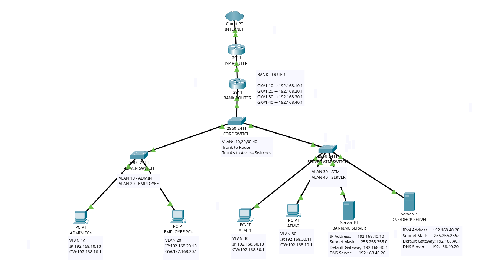
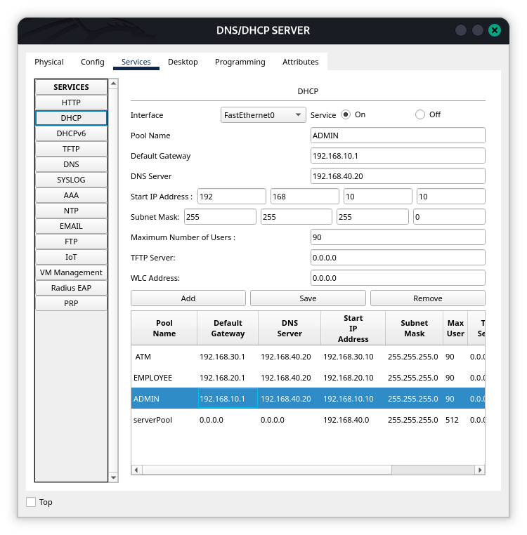
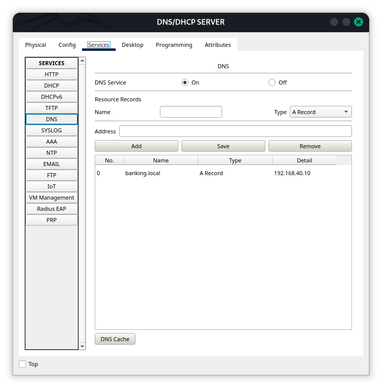
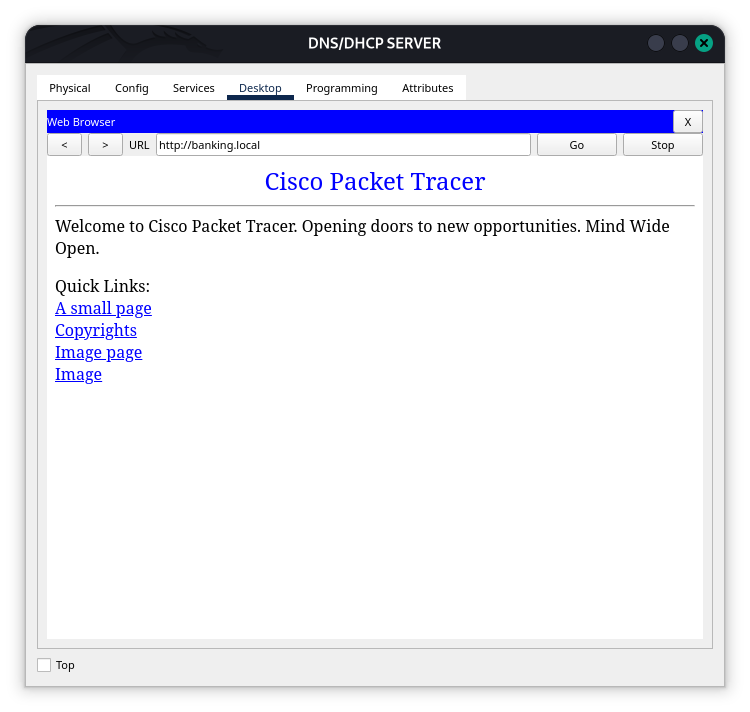
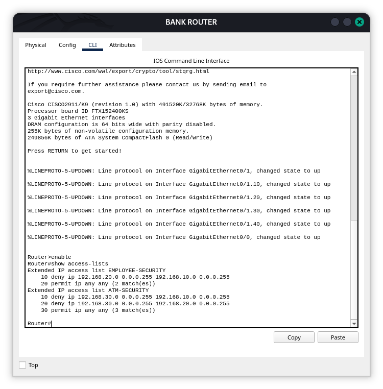
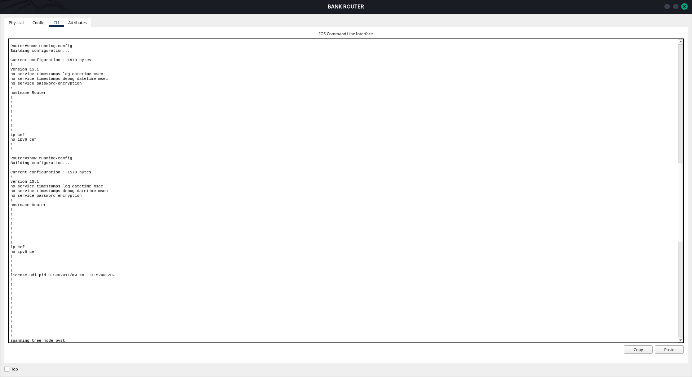
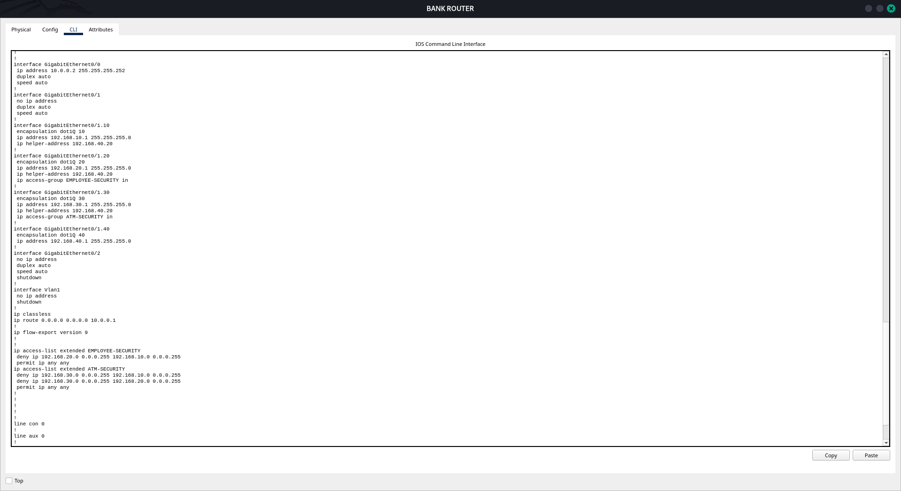
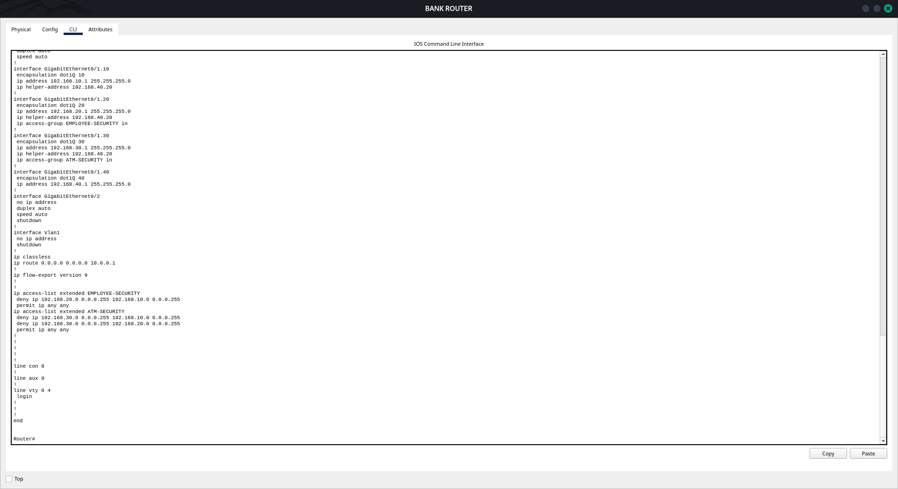
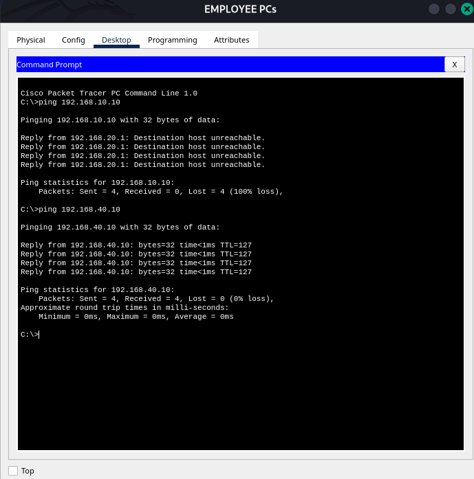
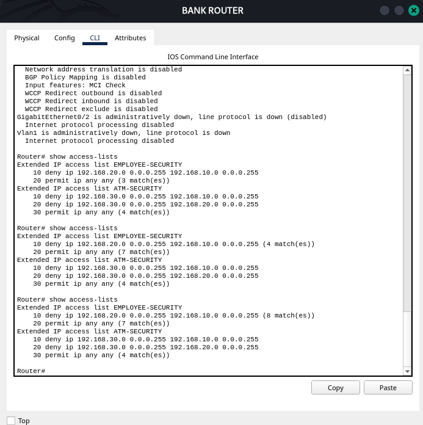

# Bank Secure Network

A segmented banking network designed and simulated in **Cisco Packet Tracer**, featuring VLAN segmentation, router-on-a-stick inter-VLAN routing, centralized DHCP/DNS, an internal banking server, and ACL-based restrictions between selected network segments.


> **Jump to:** [Overview](#overview) · [Architecture](#network-architecture) · [VLAN/IP Plan](#vlan--ip-addressing) · [Services](#network-services) · [Security](#security-architecture) · [Testing](#testing--verification) · [Screenshots](#screenshots) · [Documentation](#documentation) · [Presentation](#presentation)

---

## Overview

**Bank Secure Network** is a personal portfolio project simulating the core network infrastructure of a small bank branch. It was built in Cisco Packet Tracer to demonstrate hands-on experience with enterprise networking fundamentals: topology design, VLAN segmentation, routing, centralized services, and access control lists.

The goal was to separate different types of banking traffic (administrative, employee, ATM and server) into their own VLANs, route between them through a single router, and use ACLs to restrict specific flows toward the Admin and Employee networks.

## Problem Statement

A flat, unsegmented network is a liability in any environment handling sensitive data, especially banking. Without segmentation and access control:

- ATMs, employee workstations and administrative systems share the same broadcast domain and attack surface.
- A compromised or misconfigured device on one segment can freely reach every other segment.
- There is no way to restrict traffic between departments or device types.

This project addresses that by segmenting the network into functional VLANs and applying ACLs at the router to block specific inter-VLAN flows.

## Objectives

- Design a segmented topology with Admin, Employee, ATM and Server zones.
- Configure VLANs with assigned access ports and 802.1Q trunking.
- Implement router-on-a-stick inter-VLAN routing.
- Configure centralized DHCP with DHCP relay (`ip helper-address`) and internal DNS.
- Configure an internal banking server (HTTP, HTTPS and FTP services documented).
- Implement ACLs that restrict Employee and ATM traffic toward the Admin network (and ATM traffic toward the Employee network).
- Document the evidence collected, and be explicit about which behaviors have and have not been independently tested.

---

## Network Architecture

The network uses a single router (router-on-a-stick) connected over an 802.1Q trunk to a switching layer that serves four VLANs: Admin, Employee, ATM and Server.



*Bank Secure Network topology implemented in Cisco Packet Tracer.*

## Network Components

| Component | Quantity | Role |
|---|---|---|
| Cisco 2911 Router | 1 | Router-on-a-stick / inter-VLAN routing |
| Cisco 2960-24TT Switch | 3 | Access and trunk switching |
| Banking Server | 1 | Internal banking server (HTTP/HTTPS/FTP documented) |
| DNS/DHCP Server | 1 | Centralized DNS and DHCP |
| Admin PC | 1 | Administrative endpoint (VLAN 10) |
| Employee PC | 1 | Employee workstation (VLAN 20) |
| ATM | 2 | Simulated ATM terminals (VLAN 30) |
| Internet/Cloud | 1 | External network representation |

---

## VLAN & IP Addressing

All VLANs use the subnet mask `255.255.255.0` (`/24`), and the `.1` address of each subnet is its default gateway.

| VLAN | Name | Network | Gateway |
|---|---|---|---|
| 10 | ADMIN | `192.168.10.0/24` | `192.168.10.1` |
| 20 | EMPLOYEE | `192.168.20.0/24` | `192.168.20.1` |
| 30 | ATM | `192.168.30.0/24` | `192.168.30.1` |
| 40 | SERVER | `192.168.40.0/24` | `192.168.40.1` |

**Static server addressing (VLAN 40):**

| Server | IP Address | Subnet Mask | Gateway | DNS |
|---|---|---|---|---|
| BANKING-SERVER | `192.168.40.10` | `255.255.255.0` | `192.168.40.1` | `192.168.40.20` |
| DNS/DHCP-SERVER | `192.168.40.20` | `255.255.255.0` | `192.168.40.1` | `192.168.40.20` |

Full breakdown: [IP & VLAN Plan](./documentation/IP-VLAN-Plan.md)

---

## Routing Architecture

Inter-VLAN routing uses **router-on-a-stick**: a single physical link from the Cisco 2911 router to the switching layer is configured as an 802.1Q trunk, with a subinterface per VLAN (10, 20, 30, 40) acting as that VLAN's default gateway.

Traffic between VLANs is routed through the router, where ACLs can restrict specific flows (see [Security Architecture](#security-architecture)). VLAN separation alone does not stop routed traffic between VLANs.

Full breakdown: [Network Design](./documentation/Network-Design.md)

---

## Network Services

The table below describes the **documented configuration**. Whether each service works end to end is tracked separately in [Testing & Verification](#testing--verification).

| Service | Documented configuration |
|---|---|
| **DHCP** | Centralized DHCP server on VLAN 40 with pools for the ADMIN, EMPLOYEE and ATM VLANs |
| **DHCP Relay** | `ip helper-address` on the router subinterfaces so clients in other VLANs can reach the DHCP server |
| **DNS** | Internal DNS record for `banking.local` → `192.168.40.10` |
| **HTTP / HTTPS / FTP** | Services configured on the banking server |

**DHCP pools** (starting addresses are the documented first address of each pool, not confirmed leases for individual clients):

| Pool | Gateway | DNS | Pool Starting Address | Subnet Mask |
|---|---|---|---|---|
| ADMIN | `192.168.10.1` | `192.168.40.20` | `192.168.10.10` | `255.255.255.0` |
| EMPLOYEE | `192.168.20.1` | `192.168.40.20` | `192.168.20.10` | `255.255.255.0` |
| ATM | `192.168.30.1` | `192.168.40.20` | `192.168.30.10` | `255.255.255.0` |

**Configuration screenshots:**







Full breakdown: [Network Design](./documentation/Network-Design.md) · [IP & VLAN Plan](./documentation/IP-VLAN-Plan.md)

---

## Security Architecture

ACLs are applied on the router to restrict specific inter-VLAN flows. Each ACL denies specific traffic and then **explicitly permits other IPv4 traffic** (`permit ip any any`), so these ACLs block only the flows listed below. They are stateless IPv4 packet filters and do not provide complete banking security.

| ACL | Applied | Denies | Then |
|---|---|---|---|
| `EMPLOYEE-SECURITY` | Inbound on the VLAN 20 subinterface (`GigabitEthernet0/1.20`) | IPv4 from `192.168.20.0/24` (Employee) to `192.168.10.0/24` (Admin) | Permits other IPv4 traffic |
| `ATM-SECURITY` | Inbound on the VLAN 30 subinterface (`GigabitEthernet0/1.30`) | IPv4 from `192.168.30.0/24` (ATM) to `192.168.10.0/24` (Admin); IPv4 from `192.168.30.0/24` (ATM) to `192.168.20.0/24` (Employee) | Permits other IPv4 traffic |

The exact rules, interface assignments, rule-by-rule explanation and test evidence are documented in [ACL Configuration & Security Implementation](./documentation/acl-config.md).

**Configuration evidence:**









---

## Testing & Verification

This table reflects the evidence **currently documented**, not every possible network behavior. Configuration screenshots show how something was set up; they are not treated as proof that a service works end to end.

**Status key:** `PASS` = tested with documented evidence · `NOT TESTED` = configured, no dedicated test documented · `NOT VERIFIED` = no clear end-to-end evidence documented in this README

| Test | Source → Destination | Documented result | Status |
|---|---|---|---|
| Employee → Admin restriction | Employee PC (VLAN 20) → `192.168.10.10` (Admin) | Ping failed: four destination-host-unreachable messages from `192.168.20.1`; zero of four ping replies were received. | **PASS** (traffic blocked as intended) |
| ACL counter verification | `EMPLOYEE-SECURITY` deny rule | Deny counter increased from 4 to 8 during repeated blocked-traffic tests | **PASS** |
| Employee → Banking Server | Employee PC (VLAN 20) → `192.168.40.10` | Ping succeeded with 0% packet loss (ICMP reachability only; does not verify HTTP/HTTPS) | **PASS** |
| ATM → Admin restriction | ATM (VLAN 30) → Admin (VLAN 10) | Deny rule configured; no dedicated connectivity test documented | **NOT TESTED** |
| ATM → Employee restriction | ATM (VLAN 30) → Employee (VLAN 20) | Deny rule configured; no dedicated connectivity test documented | **NOT TESTED** |
| ATM → Banking Server | ATM (VLAN 30) → `192.168.40.10` | Permitted by the ACL's final rule; no connectivity test documented | **NOT TESTED** |
| DHCP address assignment | ADMIN / EMPLOYEE / ATM clients | Server configuration documented; end-to-end lease results not transcribed here | **NOT VERIFIED** |
| DNS resolution of `banking.local` | Client → `192.168.40.20` | Record configuration documented; resolution result not transcribed here | **NOT VERIFIED** |
| HTTP / HTTPS access | Client → Banking Server | Service configuration documented; no access test documented | **NOT VERIFIED** |
| FTP access | Client → Banking Server | Service configuration documented; no access test documented | **NOT VERIFIED** |

**Evidence for the Employee tests:**





The inbound assignment of `EMPLOYEE-SECURITY` together with the increasing deny counter supports the conclusion that the Employee-to-Admin restriction was functioning during the test. The ATM restrictions still need a dedicated test. Full details: [ACL Configuration & Security Implementation](./documentation/acl-config.md).

---

## Screenshots

| Screenshot | Description |
|---|---|
| [`topology.png`](./screenshots/topology.png) | Network topology |
| [`vlan-config.png`](./screenshots/vlan-config.png) | VLAN creation and access-port assignment |
| [`trunk-config.png`](./screenshots/trunk-config.png) | 802.1Q trunk configuration |
| [`dhcp.png`](./screenshots/dhcp.png) | DHCP server pool configuration |
| [`dhcp-client.png`](./screenshots/dhcp-client.png) | Client-side DHCP screenshot |
| [`dns.png`](./screenshots/dns.png) | DNS server record configuration |
| [`dns-test.png`](./screenshots/dns-test.png) | DNS test screenshot |
| [`banking-server.png`](./screenshots/banking-server.png) | Banking server configuration/access |
| [`alc-config.png`](./screenshots/alc-config.png) | ACL configuration |
| [`acl-application-01.png`](./screenshots/acl-application-01.png) | ACL application evidence |
| [`acl-application-02.png`](./screenshots/acl-application-02.png) | ACL application evidence |
| [`acl-application-03.png`](./screenshots/acl-application-03.png) | ACL application evidence |
| [`acl-testing.png`](./screenshots/acl-testing.png) | ACL testing screenshot |
| [`employee-acl-connectivity-test.png`](./screenshots/employee-acl-connectivity-test.png) | Employee-to-Admin blocked ping and Employee-to-Banking-Server ping |
| [`employee-acl-counter-verification.png`](./screenshots/employee-acl-counter-verification.png) | Employee ACL deny-counter verification |

Browse all: [screenshots/](./screenshots/)

---

## Technologies Used

| Category | Technology |
|---|---|
| Switching | VLANs, access ports, 802.1Q trunking |
| Routing | Router-on-a-stick, inter-VLAN routing |
| Addressing | IPv4, subnetting |
| Services | DHCP, DHCP relay, DNS, HTTP, HTTPS, FTP (as documented) |
| Security | Access Control Lists (ACLs) |
| Simulation | Cisco Packet Tracer |

---

## Project Structure

```
bank-secure-network/
│
├── README.md
│
├── packet-tracer/
│   ├── Bank-Secure-Network-FINAL.pkt
│   └── readme.md
│
├── documentation/
│   ├── Bank-Secure-Network-Documentation-LibreOffice.pdf
│   ├── acl-config.md
│   ├── IP-VLAN-Plan.md
│   ├── Network-Design.md
│   └── README.md
│
├── screenshots/
│   ├── topology.png
│   ├── vlan-config.png
│   ├── trunk-config.png
│   ├── dhcp.png
│   ├── dhcp-client.png
│   ├── dns.png
│   ├── dns-test.png
│   ├── banking-server.png
│   ├── alc-config.png
│   ├── acl-application-01.png
│   ├── acl-application-02.png
│   ├── acl-application-03.png
│   ├── acl-testing.png
│   ├── employee-acl-connectivity-test.png
│   ├── employee-acl-counter-verification.png
│   └── README.md
│
└── presentation/
    └── README.md
```

- [📁 Packet Tracer](./packet-tracer/) — [`Bank-Secure-Network-FINAL.pkt`](./packet-tracer/Bank-Secure-Network-FINAL.pkt)
- [📁 Documentation](./documentation/)
- [📁 Screenshots](./screenshots/)
- [📁 Presentation](./presentation/)

---

## How to Open the Project

1. Clone or download this repository.
2. Install [Cisco Packet Tracer](https://www.netacad.com/courses/packet-tracer) if you don't already have it.
3. Open [`packet-tracer/Bank-Secure-Network-FINAL.pkt`](./packet-tracer/Bank-Secure-Network-FINAL.pkt). See the [Packet Tracer instructions](./packet-tracer/readme.md).
4. Review the router, switch and server configurations directly in Packet Tracer.
5. Cross-reference the [documentation](./documentation/) for design rationale, addressing and ACL details.
6. Review the [screenshots](./screenshots/) for configuration and testing evidence.

---

## Documentation

- [Technical Documentation (PDF)](./documentation/Bank-Secure-Network-Documentation-LibreOffice.pdf)
- [ACL Configuration & Security Implementation](./documentation/acl-config.md)
- [IP & VLAN Plan](./documentation/IP-VLAN-Plan.md)
- [Network Design](./documentation/Network-Design.md)
- [Documentation Index](./documentation/README.md)
- [Packet Tracer Instructions](./packet-tracer/readme.md)

## Presentation

The [`presentation/`](./presentation/) directory currently contains only a [README](./presentation/README.md); no presentation file (such as a PPTX) is included in the repository at this time.

---

## Project Information

This is an independent, self-directed portfolio project designed, configured and documented as a hands-on exercise in networking and network security fundamentals.

## Future Improvements

> The items below are **not implemented**. They are planned future directions.

- Dedicated connectivity tests for the ATM-to-Admin and ATM-to-Employee ACL restrictions
- End-to-end test evidence for DHCP, DNS, HTTP/HTTPS and FTP
- More granular ACLs (specific hosts, protocols and ports instead of `permit ip any any`)
- Dedicated firewall appliance
- IDS/IPS integration
- Stronger authentication mechanisms (AAA/RADIUS)
- Network monitoring and logging (e.g., SNMP, Syslog)
- Redundancy (HSRP/VRRP, redundant links)
- VPN connectivity for remote access
- Improved server-side hardening

## Disclaimer

This project is an **educational simulation** built in Cisco Packet Tracer for learning and portfolio purposes only. It is **not** a production banking network and does not implement production-grade banking security controls. It should not be interpreted as representing enterprise-grade or regulatory-compliant banking infrastructure.
