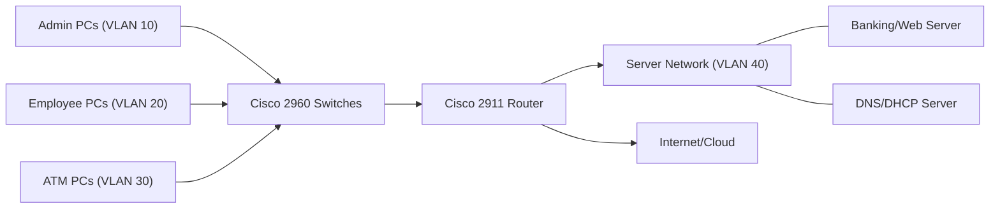

# Bank Secure Network — Network Design

## 1. Overview

The **Bank Secure Network** is a Computer Networks project designed and simulated in **Cisco Packet Tracer**. It models the network of a bank in which administrative users, employees, ATMs and core banking services must coexist while remaining logically separated from one another.

This document describes the **design and architecture** of the network: how it is structured, why it is structured that way, and how traffic moves through it. It does not cover device configuration commands. The implemented ACL rules and the tests performed are documented in [ACL Configuration & Security Implementation](acl-config.md), and the full addressing plan is in the [IP & VLAN Plan](IP-VLAN-Plan.md).

This is an **educational simulation**, not a production banking network.

## 2. Network Topology

The physical topology consists of the following devices:

| Component | Quantity / Detail |
|---|---|
| Internet/Cloud | External network connection |
| Router | Cisco 2911 |
| Switches | Three Cisco 2960 |
| End devices | Admin PCs, Employee PCs, ATM PCs |
| Servers | Banking/Web Server, DNS/DHCP Server |

**How the components are connected**

- The **Internet/Cloud** connects to the **Cisco 2911 router**, which forms the network's edge and its central point of routing.
- The router connects to the **Cisco 2960 switches**, which provide network access to the devices in the bank.
- **Admin PCs, Employee PCs and ATM PCs** connect to the switches as end devices.
- The **Banking/Web Server** and **DNS/DHCP Server** also connect through the switching layer and sit in the dedicated server segment.

**Overall flow:** end devices connect to the switches; the switches carry their traffic to the router; the router forwards traffic to the required server network or toward the Internet/Cloud.

## 3. Logical Network Design

While the physical topology describes *how devices are cabled*, the logical design describes *how the network is divided*. The network is segmented into four VLANs, each serving a distinct group of devices.

| VLAN | Name | Why this segment exists |
|---|---|---|
| 10 | ADMIN | Groups administrative users so that management-level access is kept separate from everyday user traffic. |
| 20 | EMPLOYEE | Groups bank employees' workstations into their own segment for regular day-to-day operations. |
| 30 | ATM | Isolates ATM-related systems, which have different trust and access requirements from staff workstations. |
| 40 | SERVER | Hosts the banking and network services (Banking/Web Server and DNS/DHCP Server) in a dedicated segment. |

**How segmentation helps**

- **Organization:** devices are grouped by role, which makes the network easier to understand, address and manage.
- **Broadcast separation:** each VLAN is a separate Layer 2 broadcast domain, so broadcast traffic in one segment (for example, unwanted broadcasts) does not spread to the others.
- **Routed boundaries:** communication between VLANs must pass through the router, which is where it can be filtered by ACLs. VLAN segmentation alone does not guarantee security: once routing is in place, traffic between VLANs is allowed unless the router restricts it.

## 4. Physical/Device Design

Each major component has a distinct role.

| Device | Role |
|---|---|
| **Cisco 2911 Router** | Provides Layer 3 routing between VLANs using router-on-a-stick, acts as the default gateway for each VLAN, connects the internal network to the Internet/Cloud, and applies the ACLs. |
| **Cisco 2960 Switches (×3)** | Provide Layer 2 connectivity for end devices and servers, and carry traffic for the separate VLANs. |
| **Admin PCs** | Workstations for administrative users (VLAN 10). |
| **Employee PCs** | Workstations for bank employees (VLAN 20). |
| **ATM PCs** | Simulated ATM systems (VLAN 30). |
| **Banking/Web Server** | Hosts the banking/web service in the design (VLAN 40). |
| **DNS/DHCP Server** | Designed to provide name resolution and dynamic IP addressing to the network (VLAN 40). |

**In short:** switches connect and separate devices at Layer 2, the router connects the separated segments at Layer 3, and the servers provide the services that clients are designed to depend on.

## 5. IP Addressing & VLAN Design

All VLANs use the subnet mask `255.255.255.0` (`/24`), and the `.1` address of each subnet is its default gateway.

| VLAN ID | VLAN Name | Purpose | Subnet | Default Gateway |
|:---:|---|---|---|---|
| 10 | ADMIN | Administrative users | `192.168.10.0/24` | `192.168.10.1` |
| 20 | EMPLOYEE | Bank employees | `192.168.20.0/24` | `192.168.20.1` |
| 30 | ATM | ATM-related systems | `192.168.30.0/24` | `192.168.30.1` |
| 40 | SERVER | Banking and network services | `192.168.40.0/24` | `192.168.40.1` |

**Server addressing (VLAN 40)**

| Server | IP Address |
|---|---|
| Banking/Web Server | `192.168.40.10` |
| DNS/DHCP Server | `192.168.40.20` |

> **Note:** Individual client PC addresses are not listed in this document. See the [IP & VLAN Plan](IP-VLAN-Plan.md) for the documented DHCP pool starting addresses.

## 6. Inter-VLAN Communication

Devices in different VLANs cannot communicate with each other at Layer 2. To exchange traffic, they must go through a Layer 3 device: in this design, the **Cisco 2911 router**, using **router-on-a-stick** (one trunk link with a subinterface per VLAN).

**At a high level:**

1. A device sends traffic destined for another VLAN to its **default gateway** (for example, `192.168.10.1` for VLAN 10).
2. The router receives the traffic and makes a routing decision based on the destination network.
3. If an ACL applies on the arriving subinterface, the router evaluates it; traffic that is permitted is forwarded toward the destination VLAN.

**Intended design vs. configured controls**

- **Design intent:** clients need access to shared services such as the banking server and the DNS/DHCP server, so VLANs cannot be completely isolated. At the same time, routing all inter-VLAN traffic through one point allows specific communication to be restricted.
- **Configured controls:** the implemented ACLs restrict only specific flows: Employee traffic toward the Admin network, and ATM traffic toward the Admin and Employee networks (see [Section 8](#8-security-oriented-design)). Other IPv4 traffic from those VLANs is explicitly permitted.

## 7. Server Network Design

The **Banking/Web Server** and **DNS/DHCP Server** are placed together in the dedicated **SERVER VLAN (VLAN 40)**.

**Reasons for this placement**

- **Separation of critical services:** keeping the servers out of the user and ATM segments places them in their own broadcast domain and subnet.
- **Single routed entry point:** because clients reach the servers through the router, access to the server network can be managed in one place.
- **Shared, central services:** the design places DNS/DHCP and banking services in a central, dedicated segment intended to serve clients across the VLANs. End-to-end access to these services has not been independently verified.
- **Easier management:** grouping servers together keeps the addressing and administration of services simple and predictable.

> The current ACLs do not restrict traffic toward the Server VLAN; they permit it. The server segment is separated by addressing and routing, but access to it is not filtered by the implemented ACLs.

## 8. Security-Oriented Design

The security model documented here is based on two mechanisms:

**1. VLAN segmentation**
- Admin, employee, ATM and server devices are separated into different VLANs and subnets.
- Each group is its own broadcast domain, but communication between groups is routed, not blocked, unless an ACL restricts it.

**2. ACL-based restrictions**
- Because inter-VLAN traffic is routed, ACLs on the router can restrict specific flows.

**Implemented ACLs** (extended, named, on the Cisco 2911 router)

| ACL | Applied | Denies | Then |
|---|---|---|---|
| `EMPLOYEE-SECURITY` | Inbound on `GigabitEthernet0/1.20` (VLAN 20) | IPv4 from `192.168.20.0/24` to `192.168.10.0/24` | `permit ip any any` |
| `ATM-SECURITY` | Inbound on `GigabitEthernet0/1.30` (VLAN 30) | IPv4 from `192.168.30.0/24` to `192.168.10.0/24`; IPv4 from `192.168.30.0/24` to `192.168.20.0/24` | `permit ip any any` |

These are **specific IPv4 restrictions, not a comprehensive least-privilege policy**. Because each ACL ends with `permit ip any any`, other IPv4 traffic that does not match a deny rule is permitted. The ACLs are stateless packet filters; they do not authenticate users, inspect packet contents or encrypt traffic.

**Verification status**

| Item | Status |
|---|---|
| Employee → Admin (`192.168.10.10`) | **Tested:** the ping was blocked, with four destination-host-unreachable messages from `192.168.20.1`, and the ACL deny counter increased during repeated testing |
| Employee → Banking Server (`192.168.40.10`) | **Tested:** ping succeeded with 0% packet loss (confirms ICMP reachability only) |
| ATM → Admin and ATM → Employee restrictions | Configured; **not independently verified** by the available evidence |
| ATM → server connectivity | **Not independently verified** |
| DHCP, DNS, HTTP, HTTPS and FTP end-to-end behavior | **Not independently verified** |

See [ACL Configuration & Security Implementation](acl-config.md) for the rules, interface assignments and test evidence.

**Scope of this design:** the security model documented here is limited to VLAN segmentation and these ACL restrictions. Other security controls are outside the scope of this document and are not claimed as part of this design.

## 9. Network Design Flow

The logical flow of traffic through the network is:

1. **Users and ATMs** (Admin, Employee and ATM PCs) connect to the **switches**.
2. The **switches** keep each VLAN's traffic separate and pass it toward the **router**.
3. The **router** acts as the gateway for each VLAN, applies the ACLs on the Employee and ATM subinterfaces, and decides where the traffic should go.
4. Permitted traffic is forwarded to the **required service or network**: the **server network (VLAN 40)** for banking and DNS/DHCP services, or the **Internet/Cloud** for external connectivity.

## 10. Design Rationale

A banking environment has requirements that a simple, flat network cannot meet well. The table below separates what the design provides from what is actually configured and evidenced.

| Requirement | How the design addresses it | Status |
|---|---|---|
| **Separation of roles** | Admin, employee, ATM and server devices each have their own VLAN and subnet. | Designed and documented |
| **Protection of critical services** | Banking and network services are placed in a dedicated server VLAN. | Separated by VLAN and subnet; traffic toward it is permitted by the current ACLs |
| **Controlled access** | Inter-VLAN traffic passes through the router, where ACLs can restrict it. | Employee → Admin, ATM → Admin and ATM → Employee deny rules configured; only Employee → Admin tested |
| **Organized addressing** | Each VLAN has its own subnet and gateway. | Documented in [IP & VLAN Plan](IP-VLAN-Plan.md) |
| **Manageability** | A small, layered design (switches for access, one router for routing) is easy to understand, document and troubleshoot. | Design choice |
| **Suitability for the project scope** | The design demonstrates core networking concepts (VLANs, inter-VLAN routing and basic access restrictions) within Cisco Packet Tracer. | Educational simulation |

## 11. Summary

The Bank Secure Network uses a **Cisco 2911 router** and **three Cisco 2960 switches** to connect Admin, Employee and ATM devices to the banking services and the Internet/Cloud. The network is **logically divided into four VLANs** (ADMIN 10, EMPLOYEE 20, ATM 30 and SERVER 40), each with its own `/24` subnet. The router provides inter-VLAN routing, and two ACLs restrict specific flows: Employee traffic toward Admin, and ATM traffic toward Admin and Employee. All other IPv4 traffic from those VLANs is permitted.

The available evidence validates the Employee-to-Admin restriction and Employee-to-Banking-Server ICMP reachability. ATM restrictions and end-to-end DHCP, DNS, HTTP, HTTPS and FTP behavior have not been independently verified. This is an educational Cisco Packet Tracer simulation and not a production banking network.
